# ERD CSDL chính thức `kltn_management`

Sơ đồ chỉ chứa 32 bảng nghiệp vụ của revision `20261015_0001_official`; cột đầy đủ, CHECK/UNIQUE và giải nghĩa nằm trong [từ điển dữ liệu](database-dictionary.md).

```mermaid
erDiagram
    academic_year {
        uuid id PK
    }
    advisor_assignment {
        uuid thesis_id FK
        uuid lecturer_id FK
        uuid assigned_by FK
        uuid id PK
    }
    audit_event {
        uuid actor_id FK
        uuid id PK
    }
    department {
        uuid faculty_id FK
        uuid id PK
    }
    document {
        uuid thesis_id FK
        uuid id PK
    }
    document_version {
        uuid document_id FK
        uuid stored_file_id FK
        uuid submitted_by FK
        uuid id PK
    }
    eligibility_snapshot {
        uuid student_id FK
        uuid round_id FK
        uuid confirmed_by FK
        uuid id PK
    }
    faculty {
        uuid id PK
    }
    lecturer_profile {
        uuid user_id FK
        uuid department_id FK
        uuid id PK
    }
    member_work_assignment {
        uuid thesis_member_id FK
        uuid reviewed_by FK
        uuid id PK
    }
    organizational_position {
        uuid id PK
    }
    position_assignment {
        uuid lecturer_id FK
        uuid position_id FK
        uuid faculty_id FK
        uuid department_id FK
        uuid id PK
    }
    progress_milestone {
        uuid round_id FK
        uuid id PK
    }
    progress_report {
        uuid thesis_id FK
        uuid milestone_id FK
        uuid evidence_file_id FK
        uuid submitted_by FK
        uuid id PK
    }
    progress_review {
        uuid progress_report_id FK
        uuid reviewer_id FK
        uuid id PK
    }
    proposal {
        uuid thesis_id FK
        uuid id PK
    }
    proposal_review {
        uuid proposal_version_id FK
        uuid reviewer_assignment_id FK
        uuid reviewer_user_id FK
        uuid id PK
    }
    proposal_version {
        uuid proposal_id FK
        uuid stored_file_id FK
        uuid submitted_by FK
        uuid id PK
    }
    registration_member {
        uuid registration_id FK
        uuid round_id FK
        uuid student_id FK
        uuid evidence_file_id FK
        uuid responded_by_user_id FK
        uuid id PK
    }
    resource_assignment {
        uuid user_id FK
        uuid round_id FK
        uuid thesis_id FK
        uuid id PK
    }
    reviewer_assignment {
        uuid lecturer_id FK
        uuid proposal_id FK
        uuid thesis_id FK
        uuid assigned_by FK
        uuid id PK
    }
    signature_confirmation {
        uuid proposal_id FK
        int proposal_version_no FK
        uuid signer_user_id FK
        uuid id PK
    }
    stored_file {
        uuid id PK
    }
    student_profile {
        uuid user_id FK
        uuid department_id FK
        uuid id PK
    }
    thesis {
        uuid round_id FK
        uuid topic_id FK
        uuid registration_id FK
        uuid department_id FK
        uuid id PK
    }
    thesis_member {
        uuid thesis_id FK
        uuid student_id FK
        uuid id PK
    }
    thesis_round {
        uuid academic_year_id FK
        uuid id PK
    }
    topic {
        uuid round_id FK
        uuid receiving_lecturer_id FK
        uuid department_id FK
        uuid proposer_user_id FK
        uuid decided_by FK
        uuid id PK
    }
    topic_registration {
        uuid round_id FK
        uuid topic_id FK
        uuid created_by FK
        uuid lecturer_decided_by FK
        uuid department_finalized_by FK
        uuid id PK
    }
    topic_requirement {
        uuid topic_id FK
        uuid id PK
    }
    topic_title_version {
        uuid topic_id FK
        uuid changed_by FK
        uuid id PK
    }
    user_account {
        uuid id PK
    }
    user_account ||--o{ advisor_assignment : assigned_by
    lecturer_profile ||--o{ advisor_assignment : lecturer_id
    thesis ||--o{ advisor_assignment : thesis_id
    user_account o|--o{ audit_event : actor_id
    faculty ||--o{ department : faculty_id
    thesis ||--o{ document : thesis_id
    document ||--o{ document_version : document_id
    stored_file ||--o{ document_version : stored_file_id
    student_profile ||--o{ document_version : submitted_by
    user_account o|--o{ eligibility_snapshot : confirmed_by
    thesis_round ||--o{ eligibility_snapshot : round_id
    student_profile ||--o{ eligibility_snapshot : student_id
    department ||--o{ lecturer_profile : department_id
    user_account ||--o{ lecturer_profile : user_id
    lecturer_profile o|--o{ member_work_assignment : reviewed_by
    thesis_member ||--o{ member_work_assignment : thesis_member_id
    department o|--o{ position_assignment : department_id
    faculty o|--o{ position_assignment : faculty_id
    lecturer_profile ||--o{ position_assignment : lecturer_id
    organizational_position ||--o{ position_assignment : position_id
    thesis_round ||--o{ progress_milestone : round_id
    stored_file o|--o{ progress_report : evidence_file_id
    progress_milestone ||--o{ progress_report : milestone_id
    student_profile ||--o{ progress_report : submitted_by
    thesis ||--o{ progress_report : thesis_id
    progress_report ||--o{ progress_review : progress_report_id
    lecturer_profile ||--o{ progress_review : reviewer_id
    thesis ||--o{ proposal : thesis_id
    proposal_version ||--o{ proposal_review : proposal_version_id
    reviewer_assignment ||--o{ proposal_review : reviewer_assignment_id
    user_account ||--o{ proposal_review : reviewer_user_id
    proposal ||--o{ proposal_version : proposal_id
    stored_file ||--o{ proposal_version : stored_file_id
    student_profile ||--o{ proposal_version : submitted_by
    stored_file o|--o{ registration_member : evidence_file_id
    topic_registration ||--o{ registration_member : registration_id
    user_account o|--o{ registration_member : responded_by_user_id
    student_profile ||--o{ registration_member : student_id
    thesis_round o|--o{ resource_assignment : round_id
    thesis o|--o{ resource_assignment : thesis_id
    user_account ||--o{ resource_assignment : user_id
    user_account ||--o{ reviewer_assignment : assigned_by
    lecturer_profile ||--o{ reviewer_assignment : lecturer_id
    proposal o|--o{ reviewer_assignment : proposal_id
    thesis o|--o{ reviewer_assignment : thesis_id
    proposal ||--o{ signature_confirmation : proposal_id
    proposal_version ||--o{ signature_confirmation : proposal_id
    user_account ||--o{ signature_confirmation : signer_user_id
    department ||--o{ student_profile : department_id
    user_account ||--o{ student_profile : user_id
    department ||--o{ thesis : department_id
    topic_registration ||--o{ thesis : registration_id
    thesis_round ||--o{ thesis : round_id
    topic ||--o{ thesis : topic_id
    student_profile ||--o{ thesis_member : student_id
    thesis ||--o{ thesis_member : thesis_id
    academic_year ||--o{ thesis_round : academic_year_id
    user_account o|--o{ topic : decided_by
    department ||--o{ topic : department_id
    user_account ||--o{ topic : proposer_user_id
    lecturer_profile o|--o{ topic : receiving_lecturer_id
    thesis_round ||--o{ topic : round_id
    student_profile ||--o{ topic_registration : created_by
    user_account o|--o{ topic_registration : department_finalized_by
    lecturer_profile o|--o{ topic_registration : lecturer_decided_by
    thesis_round ||--o{ topic_registration : round_id
    topic ||--o{ topic_registration : topic_id
    topic ||--o{ topic_requirement : topic_id
    user_account ||--o{ topic_title_version : changed_by
    topic ||--o{ topic_title_version : topic_id
```

Các quan hệ tùy chọn dùng `o|`; FK bắt buộc dùng `||`. Quan hệ nhiều bản ghi dùng `o{`. Các quyền chi tiết được kiểm ở service, không suy ra từ ERD.
