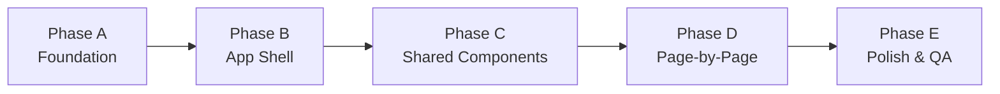

# Redesign Masterplan — Academic Precision 2.0

> Kế hoạch triển khai chi tiết cho đại cải cách giao diện KLTN.
> Nhánh: `NV6` · Ngày: 23/11/2026

---

## 0. Nguyên tắc triển khai

1. **Không đổi business logic, API, DB, auth.** Chỉ thay đổi tầng hiển thị.
2. **Không xóa chức năng đang chạy.** Mọi thao tác hiện có phải hoạt động sau khi sửa.
3. **Build phải pass sau mỗi bước.** `npx tsc --noEmit` + `npm run build` = 0 error.
4. **Commit theo bước hoàn chỉnh.** Mỗi commit là một bước hoàn thành, có thể revert an toàn.
5. **Review bằng ảnh chụp.** Mỗi bước cần screenshot BEFORE → AFTER (Playwright hoặc thủ công).

---

## 1. Thứ tự triển khai

---

## Phase A — Foundation (ước lượng: 1–2 ngày)

### A.1 Hợp nhất token layer

**BEFORE:** Hai hệ token song song (`tokens.css` + `signature.css`), 420 mã hex rời rạc, 22 cỡ chữ, 17 radius, ~40 breakpoint.

**AFTER:** Một tệp `tokens.css` chứa tất cả design tokens theo DESIGN_SYSTEM §2–8. `signature.css` chỉ còn override thẩm mỹ, không định nghĩa token mới.

**Các bước:**
1. Cập nhật `tokens.css`: thêm semantic tokens (`--color-canvas`, `--color-ink`, `--color-primary`…), thêm `--bp-*`, `--z-*`.
2. Viết script `tools/codemod_hex_to_token.py`: quét tất cả `.css`, thay hex → `var(--…)` theo bảng mapping (đầu ra: danh sách hex chưa mapping để xử lý thủ công).
3. Chạy codemod, review diff, commit.
4. Xóa token trùng lặp trong `signature.css` (giữ lại override thẩm mỹ).
5. Xóa `src/style.css` (tệp chết).

**Tệp ảnh hưởng:** `tokens.css`, `signature.css`, toàn bộ `styles/*.css` (codemod), `src/style.css` (xóa).

**Rủi ro:** Codemod sai ngữ cảnh (vd: hex trong comment hoặc chuỗi inline). Giảm thiểu: regex chỉ match thuộc tính CSS; diff thủ công.

### A.2 Chuẩn hóa breakpoint

**BEFORE:** ~40 biểu thức media query khác nhau.

**AFTER:** 4 breakpoint chuẩn + `prefers-reduced-motion` + `print`.

**Các bước:**
1. Lập bảng quy đổi: 480/520/560/600 → `640px`; 700/720/760/768/800/820/850 → `768px`; 860/900/960/1000/1023 → `1024px`; 1100/1150 → `1280px`.
2. Viết script codemod hoặc sửa thủ công từng tệp.
3. Test responsive trên 4 viewport: 375, 640, 768, 1280.

**Tệp ảnh hưởng:** Toàn bộ `styles/*.css` có media query (~18 tệp).

### A.3 Chuẩn hóa z-index

**BEFORE:** 0, 1, 2, 3, 5, 6, 30, 31, 35, 40, 45, 50, 2000, 9999.

**AFTER:** 8 bậc theo DESIGN_SYSTEM §8.

**Tệp ảnh hưởng:** `components.css`, `layout.css`, `defense.css`, `review-workspace.css`, `roster.css`.

---

## Phase B — App Shell (ước lượng: 1–2 ngày)

### B.1 Header cải tiến

**BEFORE:** Breadcrumb 2 cấp (KLTN / Trang), gốc "KLTN" không bấm được. Tên trang có 4 nguồn khác nhau.

**AFTER:** Breadcrumb 3 cấp trên trang chi tiết, cấp cha có link. Nguồn tên duy nhất từ route manifest.

**Các bước:**
1. Tạo `src/routes.ts`: manifest route gồm `{path, label, icon, group, roles, parent?}`.
2. Refactor `Header.tsx`: xóa `BREADCRUMB_MAP`, dùng manifest.
3. Refactor `App.tsx`: xóa `labels`, dùng manifest cho `document.title`.
4. Refactor `Sidebar.tsx`: dùng manifest cho label và icon.
5. Đồng bộ 7 trường hợp lệch tên (xem UI_AUDIT S-02a).

**Tệp ảnh hưởng:** `routes.ts` (mới), `Header.tsx`, `App.tsx`, `Sidebar.tsx`.

### B.2 Sidebar gọn hóa

**BEFORE:** Brand 148px, icon trùng (ClipboardList 6×, FileText 5×), mục "Đang phát triển" nằm trong nav chính, "Hồ sơ chuyên môn" không active, "Danh sách GV" lạc nhóm.

**AFTER:** Brand 88px, icon duy nhất cho mỗi mục (DESIGN_SYSTEM §11), mục planned chuyển cuối sidebar, active state chính xác, nhóm hợp lý.

**Các bước:**
1. Thu gọn `sidebar__brand`: logo 32px, 2 dòng chữ, padding giảm.
2. Đổi icon theo bảng DESIGN_SYSTEM §11.
3. Chuyển `PlannedLink` vào nhóm "Sắp có" cuối sidebar, badge "Beta".
4. Chuyển "Danh sách GV" sang nhóm "Tài liệu Khoa" (cùng Kho biểu mẫu, Kho KL).
5. Sửa "Hồ sơ chuyên môn" dùng `NavLink` với check `?section=lecturer-profile`.
6. Thêm `title` cho các mục thiếu khi collapsed.

**Tệp ảnh hưởng:** `Sidebar.tsx`, `signature.css`.

### B.3 PageHeader giảm mô tả

**BEFORE:** Mô tả có trang dài đến 343 ký tự.

**AFTER:** Tối đa 90 ký tự. Hướng dẫn dài chuyển vào empty state hoặc "Hướng dẫn" thu gọn.

**Tệp ảnh hưởng:** ~26 PageHeader trong 26 trang (xem danh sách trong audit).

---

## Phase C — Shared Components (ước lượng: 2–3 ngày)

### C.1 Tabs component

**BEFORE:** Tab dùng `btn-primary/btn-secondary` toggle, không phân biệt với nhóm nút, không có ARIA.

**AFTER:** `<Tabs>` component: underline style, `role="tablist"`, `role="tab"`, `aria-selected`, keyboard arrow nav.

**Tệp mới:** `src/components/ui/Tabs.tsx`, CSS trong `components.css`.
**Tệp sửa:** `DefensePage.tsx` (2 tầng tab → page tabs = Tabs, session steps = process rail), `ThesisViewPage.tsx`, `AccountPage.tsx`, `AdministrationPage.tsx`.

### C.2 ConfirmDialog

**BEFORE:** `window.confirm` (9 chỗ) + `window.alert` (1 chỗ).

**AFTER:** `<ConfirmDialog>`: kế thừa Dialog `sm`, có icon cảnh báo, mô tả hậu quả, nút danger + ghost.

**Tệp mới:** `src/components/ui/ConfirmDialog.tsx`.
**Tệp sửa:** `DefensePage.tsx` (6), `WithdrawalsPage.tsx` (2), `DefenseScheduleNotices.tsx` (1), `DefenseCorrections.tsx` (nếu có).

### C.3 Toast

**BEFORE:** Thông báo thành công dùng banner inline đầu trang.

**AFTER:** `<Toast>` portal: hiện 4s, `role="status"`, `aria-live="polite"`, dừng hover.

**Tệp mới:** `src/components/ui/Toast.tsx`, `src/hooks/useToast.ts`.
**Tệp sửa:** Trang nào có `setMessage("Đã lưu…")` → `toast("Đã lưu…")`.

### C.4 Skeleton

**BEFORE:** 42 chỗ chữ "Đang tải…".

**AFTER:** `<Skeleton>` (rectangle), `<SkeletonTable>` (hàng placeholder), `<SkeletonCard>`.

**Tệp mới:** `src/components/ui/Skeleton.tsx`.
**Tệp sửa (ưu tiên):** `WorkspacePage.tsx` (dashboard), `DefensePage.tsx`, `RosterPage.tsx`, `TopicsPage.tsx`, `AdministrationPage.tsx`. Trang còn lại vẫn `
` nhưng đổi thành spinner inline.

### C.5 FilterBar

**BEFORE:** Mỗi trang tự làm bộ lọc: `<input>` + `<select>` tùy vị trí.

**AFTER:** `<FilterBar>`: search input + ≤3 filter + chip active + "Xóa lọc".

**Tệp mới:** `src/components/ui/FilterBar.tsx`.
**Tệp sửa:** `TopicsPage.tsx`, `RegistrationsPage.tsx`, `RosterPage.tsx`, `DefensePage.tsx` (tìm lịch), `AdministrationPage.tsx` (tìm tài khoản).

### C.6 Responsive table → card list

**BEFORE:** Bảng cuộn ngang dưới 640px.

**AFTER:** Dưới 640px bảng chuyển danh sách thẻ: 3 cột quan trọng + badge trạng thái.

**Cách làm:** CSS-only bằng `display: block / grid` cho `tr`/`td` dưới `@media (max-width: 639px)`, `td::before { content: attr(data-label) }`. Thêm `data-label` vào `<td>` trong TSX cho các bảng chính.

**Tệp ảnh hưởng:** `components.css` (quy tắc responsive table), các trang có bảng lớn (~12 trang).

---

## Phase D — Page-by-Page (ước lượng: 3–5 ngày)

### D.1 Dashboard (WorkspacePage)

| Hạng mục | BEFORE | AFTER |
|---|---|---|
| Widget đề tài/đăng ký rỗng | `
` trơn / `overview-empty` | EmptyState chuẩn |
| Chỉ có danh sách | Danh sách đơn | "Next action" card theo vai trò |
| Welcome mô tả | Chữ dài | Chữ ngắn + badge đợt đang mở |

### D.2 Đăng nhập (LoginPage)

| Hạng mục | BEFORE | AFTER |
|---|---|---|
| Form + demo ngang hàng | Demo cạnh form | Demo thu gọn "Môi trường thử nghiệm" |
| Thiếu Admin demo | 6 tài khoản | Giữ nguyên (backend scope) |

### D.3 Hội đồng & Bảo vệ (DefensePage)

| Hạng mục | BEFORE | AFTER |
|---|---|---|
| Tab trang vs tab phiên | Cùng kiểu `btn-*` | Page tabs = underline Tabs; phiên = process rail |
| Phiên bảo vệ | `
` lồng nhau | Bảng/thẻ có cột trạng thái, mở drawer hoặc trang chi tiết |
| Thao tác phá hủy | `btn-secondary` + `window.confirm` | `btn-danger` + ConfirmDialog |
| Mẫu 9 | Ẩn với vai trò khác Thư ký | Ô tài liệu khóa có chú thích |
| Phiếu chấm Mẫu 6 | Trong `
` lồng | Mở trực tiếp hoặc drawer |
| Form hội đồng | 5 select nối chuỗi dài | Combobox có tìm kiếm, option 2 dòng |
| Lọc lịch | Input + banner lỗi khi đang draft | FilterBar chuẩn, giữ form ghim đầu |

### D.4 Đề tài (TopicsPage)

| Hạng mục | BEFORE | AFTER |
|---|---|---|
| Grid thẻ | 350px min-width | Responsive grid + FilterBar |
| Mô tả PageHeader | 278 ký tự | ≤ 90 ký tự |

### D.5 Đăng ký (RegistrationsPage)

| Hạng mục | BEFORE | AFTER |
|---|---|---|
| Inline style (3 chỗ) | `style={{}}` | Class CSS |
| Mô tả PageHeader | 176 ký tự | ≤ 90 ký tự |

### D.6 Quản trị (AdministrationPage)

| Hạng mục | BEFORE | AFTER |
|---|---|---|
| 1.258 dòng | Monolith | Tách `AccountsSection.tsx` + `AssignmentsSection.tsx` |
| 12 inline style | `style={{}}` | Class CSS |
| Metric cards | Giống thẻ dashboard khác | Dùng token, số lớn 24px, nhãn 12px |

### D.7 Quản lý đợt (RoundsPage)

| Hạng mục | BEFORE | AFTER |
|---|---|---|
| Form tạo đợt | Cuộn dài | Fieldset + divider theo nhóm |
| Mô tả dài | 56 ký tự (ổn) | Giữ |

### D.8 Danh sách SV đủ điều kiện (RosterPage)

| Hạng mục | BEFORE | AFTER |
|---|---|---|
| 462 dòng | Table + import + nút rải | FilterBar chuẩn, bảng responsive |
| Inline style (2 chỗ) | `style={{}}` | Class CSS |

### D.9 Biểu mẫu Khoa (SchoolFormsPage)

| Hạng mục | BEFORE | AFTER |
|---|---|---|
| 18 `
` lồng | Khó quét | Danh sách thẻ theo đợt, nút hành động nổi |
| 4 inline style | `style={{}}` | Class CSS |
| Mô tả PageHeader | 242 ký tự | ≤ 90 ký tự |

### D.10 Tra cứu AI (AIPage)

| Hạng mục | BEFORE | AFTER |
|---|---|---|
| 24 inline style | `style={{}}` | Class CSS |
| Chat-like UI | Tự làm | Dùng card/field chuẩn |

### D.11 Các trang còn lại

| Trang | Dòng | Vấn đề chính | Hướng sửa |
|---|---:|---|---|
| ThesisViewPage | 251 | 12 inline style, lặp header | Tabs chuẩn, class CSS |
| ThesisArchivePage | 270 | Tải 4 lần "Đang tải" | Skeleton + FilterBar |
| ThesisChangesPage | 246 | — | Responsive table |
| SubmissionsPage | 78 | Mô tả 207 ký tự | Rút gọn |
| NotificationsPage | 107 | — | Giữ, thêm skeleton |
| ActivityPage | 88 | — | Giữ, thêm skeleton |
| PositionsPage | 112 | 12 long lines | Refactor JSX |
| AccountPage | 99 | — | Giữ |
| WithdrawalsPage | 123 | 2 `window.confirm` | ConfirmDialog |
| EvaluationPage | 140 | 21 long lines | Refactor JSX, responsive |
| EvaluationsPage | 38 | — | Giữ |

---

## Phase E — Polish & QA (ước lượng: 1–2 ngày)

### E.1 Loại bỏ `!important`

Quét 35 chỗ, sửa specificity bằng selector phù hợp.

### E.2 Giảm inline style

Quét 94 chỗ, chuyển sang class. Ưu tiên: AIPage (24), AdministrationPage (12), ThesisViewPage (12).

### E.3 Code splitting

- Lazy hóa: `AdministrationPage`, `RosterPage`, `TopicsPage`, `SchoolFormsPage`, `AIPage`.
- Giảm chunk chính từ 725 kB.

### E.4 Print stylesheet

- Ẩn sidebar, header, action buttons.
- Chế độ in cho phiếu chấm, biên bản, bảng điểm.

### E.5 Kiểm tra toàn diện

1. Chạy Playwright trên 4 viewport (375, 640, 768, 1280) cho mọi route.
2. Chạy axe-core cho mọi trang, fix mọi issue nghiêm trọng.
3. Chụp screenshot BEFORE/AFTER cho toàn bộ route.
4. Đo CLS, LCP trên Lighthouse.
5. Kiểm tra keyboard navigation cho tabs, dialog, combobox.

---

## Tóm tắt ước lượng

| Phase | Nội dung | Ước lượng |
|---|---|---:|
| A | Foundation (tokens, breakpoints, z-index) | 1–2 ngày |
| B | App Shell (header, sidebar, page header) | 1–2 ngày |
| C | Shared Components (Tabs, ConfirmDialog, Toast, Skeleton, FilterBar, responsive table) | 2–3 ngày |
| D | Page-by-Page (15 trang/nhóm trang) | 3–5 ngày |
| E | Polish & QA | 1–2 ngày |
| **Tổng** | | **8–14 ngày** |

> [!NOTE]
> Ước lượng dựa trên **1 kỹ sư làm full-time** với sự hỗ trợ AI. Phase A–B nên commit riêng trước vì ảnh hưởng toàn hệ thống; Phase D có thể song song hóa theo trang.

---

## Phụ lục: Danh sách tệp theo phase

### Phase A
- `tokens.css` (sửa)
- `signature.css` (sửa)
- `style.css` (xóa)
- `tools/codemod_hex_to_token.py` (mới)
- Toàn bộ `styles/*.css` (codemod)

### Phase B
- `src/routes.ts` (mới)
- `Header.tsx`, `Sidebar.tsx`, `App.tsx` (sửa)
- `signature.css` (sửa brand, sidebar)
- ~26 PageHeader trong pages (mô tả rút gọn)

### Phase C
- `src/components/ui/Tabs.tsx` (mới)
- `src/components/ui/ConfirmDialog.tsx` (mới)
- `src/components/ui/Toast.tsx` (mới)
- `src/hooks/useToast.ts` (mới)
- `src/components/ui/Skeleton.tsx` (mới)
- `src/components/ui/FilterBar.tsx` (mới)
- `components.css` (sửa: tabs, skeleton, toast, filter, responsive table)

### Phase D
- 15+ page files trong `src/pages/`
- Domain components dùng `window.confirm` (3 file)
- Domain components có inline style (10+ file)

### Phase E
- Toàn bộ CSS (loại `!important`)
- TSX có inline style (loại)
- `App.tsx` (lazy hóa thêm 5 trang)
